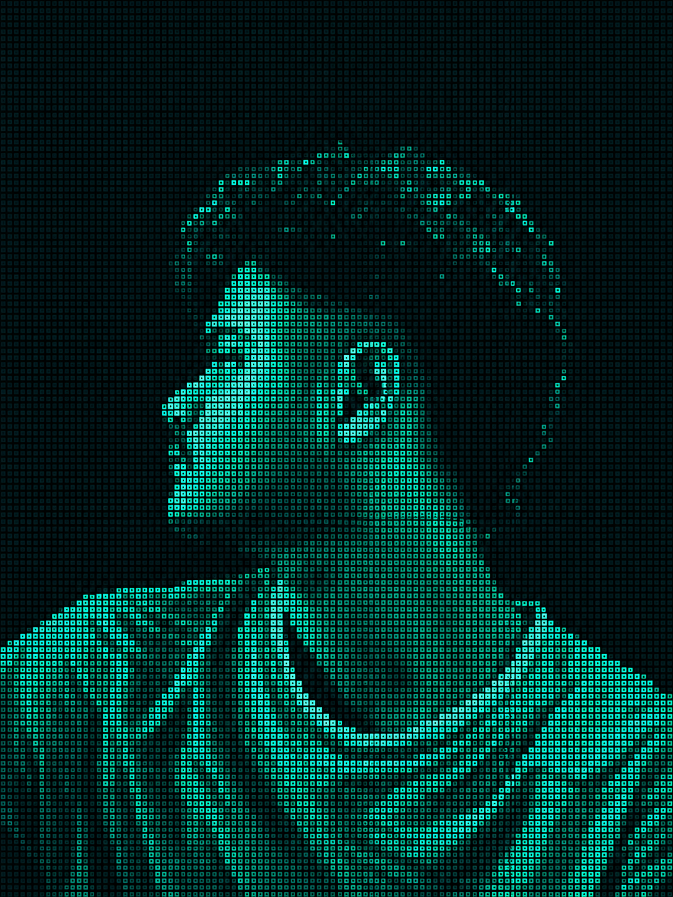

<div align="center">



# `VISH//SYS`


<h2 align="center"> &gt; ABOUT_ME.exe </h2>

<div align="center">


</div>

<table>
<tr>
<td width="50%" valign="top">

### `IDENTITY.log`

```text
NAME       : Vishvesh Raj Gupta
INSTITUTE  : IIIT Nagpur
BRANCH     : CSE (AI)
SESSION    : 2025–2029
```

</td>
<td width="50%" valign="top">

### `INTERESTS.log`

```text
01 > Machine Learning
02 > Generative AI
03 > LLMs and RAG
04 > Cybersecurity
05 > Computer Science
```

</td>
</tr>
</table>

### `CURRENT_DIRECTIVES`

- [x] Learn programming fundamentals
- [x] Build web development projects
- [ ] Strengthen machine learning foundations
- [ ] Build practical LLM and RAG applications
- [ ] Deploy projects and document experiments

<p align="center">
  <code>LEARN → EXPERIMENT → BUILD → IMPROVE</code>
</p>


**COMPUTER SCIENCE × ARTIFICIAL INTELLIGENCE**


[](https://github.com/Genne13)
[](https://www.linkedin.com/in/vishvesh-raj-gupta-820a58375)

</div>

---

## `01 // IDENTITY_SCAN`

```text
[ SYSTEM BOOT ................. OK ]
[ IDENTITY MODULE ............. OK ]
[ AI RESEARCH MODULE .......... ACTIVE ]

USER          : VISH
INSTITUTE     : IIIT NAGPUR
DISCIPLINE    : COMPUTER SCIENCE
SPECIALIZATION: ARTIFICIAL INTELLIGENCE
MISSION       : BUILD INTELLIGENT SYSTEMS

CURRENT STATE : LEARNING // EXPERIMENTING
```

## `02 // TECHNOLOGY_MODULES`

<p align="center">
  
</p>

```text
[CORE]       Programming fundamentals
[WEB]        Frontend development
[AI/ML]      Machine learning foundations
[GENAI]      LLMs, RAG and generative systems
```

## `03 // PROJECT_DATABASE`


<h2 align="center">&gt; PROJECT_DATABASE.db</h2>

<table>
<tr>
<td width="50%" valign="top">

### `MODULE_01 // MOVIEVERSE`

**Type:** Web application

Movie discovery, search, recommendations, trailers, and watchlist features.

<a href="https://github.com/Genne13?tab=repositories">[ VIEW SOURCE ]</a>

</td>
<td width="50%" valign="top">

### `MODULE_02 // CRISPR`

**Type:** Scientific timeline

A project exploring CRISPR technology and its scientific milestones.

<a href="https://github.com/Genne13?tab=repositories">[ VIEW SOURCE ]</a>

</td>
</tr>
<tr>
<td colspan="2">

### `MODULE_03 // GENERATIVE_SYSTEMS`

**Type:** Generative AI learning track

Planned experiments in LLMs, retrieval-augmented generation, and practical AI systems.

`STATUS: PLANNING`

</td>
</tr>
</table>


## `04 // GITHUB_TELEMETRY`


<h2 align="center">&gt; SYSTEM_TELEMETRY</h2>

<div align="center">


</div>


## `05 // SYSTEM_LOG`

```text
[+] Exploring computer science
[+] Developing software projects
[+] Learning machine learning
[+] Working toward practical GenAI systems

END OF TRANSMISSION_
```

<div align="center">

<sub>DESIGNED IN TERMINAL MODE · VISH//SYS</sub>

</div>
