 

 

# VISHVESH RAJ GUPTA

**COMPUTER SCIENCE · ARTIFICIAL INTELLIGENCE**

[GitHub](https://github.com/Genne13) · [LinkedIn](https://www.linkedin.com/in/vishvesh-raj-gupta-820a58375)

*Scientia. Machina. Intelligentia.*

---

  

  ARCHIVE 001 / THE ENGINEER / EST. 2026

## I. THE ENGINEER

I am a Computer Science undergraduate specializing in Artificial Intelligence at the Indian Institute of Information Technology Nagpur.

My interests lie at the intersection of machine learning, generative systems, and the engineering principles behind intelligent software.

I believe in understanding the machinery beneath the interface: the mathematics, the algorithms, the data, and the systems that make software work.

- **Primary direction:** Machine Learning and Generative AI
- **Exploring:** Large Language Models, retrieval systems, and intelligent applications
- **Engineering philosophy:** Fundamentals first. Experiments second. Reliable systems always.

## II. THE TECHNICAL ARSENAL

  
  
  
  
  
  

  RESEARCH DOMAINS  
  
  
  
  

*The research-domain labels describe my learning interests, not claims of professional mastery.*

## III. THE LABORATORY

  SELECTED EXPERIMENTS / SOFTWARE / RESEARCH

### EXP-001 · CRISPR Timeline

An educational project exploring the timeline of CRISPR technology and its scientific development.

**Focus:** Scientific communication · Web development

[Explore my repositories →](https://github.com/Genne13?tab=repositories)

### EXP-002 · MovieVerse

A movie-discovery application built around movie data, search, recommendations, and watchlist functionality.

**Focus:** JavaScript · API integration · Frontend development

[Explore my repositories →](https://github.com/Genne13?tab=repositories)

### EXP-003 · The Generative Systems Lab

A growing collection of experiments in machine learning and Generative AI, progressing from fundamentals to practical LLM-powered applications.

**Planned research areas:** Embeddings · Retrieval-Augmented Generation · Evaluation · AI application engineering

[Explore my repositories →](https://github.com/Genne13?tab=repositories)

> Project descriptions should be updated to match each repository's actual implementation. Link each title directly to its repository when ready.

## IV. THE INSTRUMENT PANEL

  
  

  Contribution history · generated from GitHub activity

  

## V. CURRENT RESEARCH NOTES

- Strengthening programming and computer science fundamentals.
- Studying machine learning concepts and model evaluation.
- Exploring how LLMs, embeddings, and retrieval can support useful applications.
- Documenting experiments with reproducible code and clear explanations.

## VI. THE PRINCIPLE

> A machine is understood not by its appearance, but by the precision of its workings.

I aim to build projects that are visually considered, technically grounded, and useful beyond a demonstration.

---

  
    
  THE ARCANE MACHINE · ENGINEERING ARCHIVE 001 
  Designed with precision. Built through experimentation.

